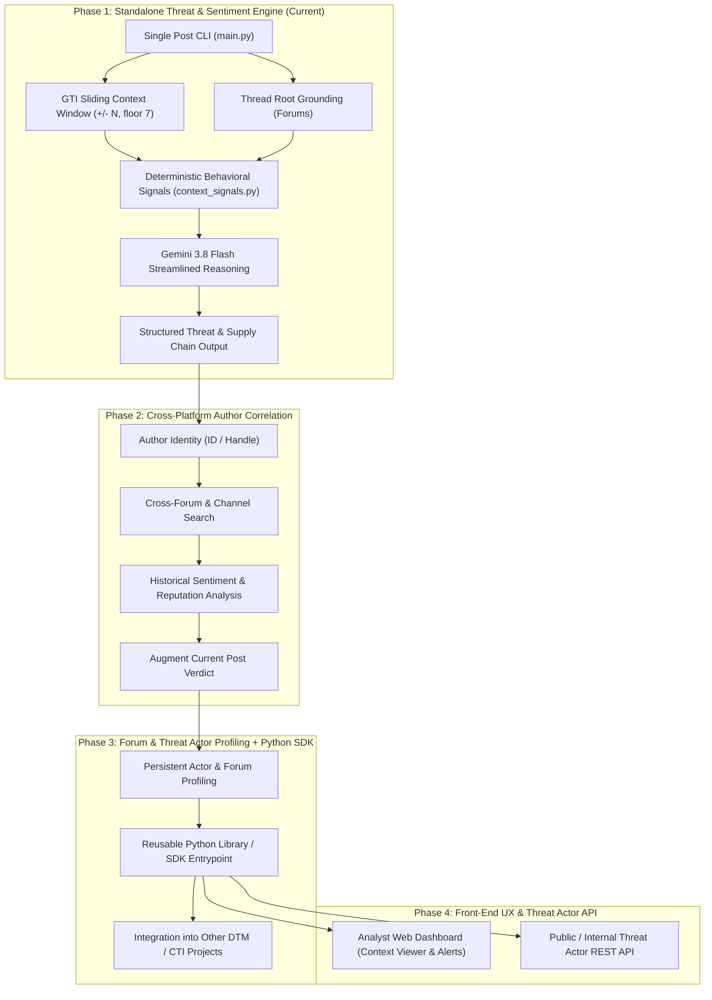

# 📄 Product Requirements Document (PRD)
## Contextual Underground Threat & Sentiment Intelligence System (CUTSIS)

**Author:** Google Threat Intelligence (GTI) Pair-Programming Team  
**Status:** Active Draft / Phase 1 Architecture  
**Target Platform:** Google Threat Intelligence (GTI) DDW API + Google Generative AI (Gemini 3.8 Flash) + Google Cloud (BigQuery)  

---

## 1. Executive Summary & Problem Statement

### 1.1 Problem Statement
In underground cybercrime forums and encrypted messenger channels (e.g., Telegram, Discord, darknet boards), isolated communications often trigger false positives or conceal true operational risk:
* **The "Isolated Post" Fallacy:** An initial access broker (IAB) claiming *"Selling administrative VPN access to Global Logistics Firm X for $5,000"* may be an active compromise, a recycled credential dump, or an outright scam. Automated keyword scrapers lack the context to distinguish genuine breaches from fraudulent chatter.
* **The Peer Signal Gap:** In underground communities, the real validation signal exists in the **immediate conversation surrounding the post**. Short messages such as `"vouch"`, `"escrow?"`, `"dm'ed"`, `"fake proof"`, or `"ripper (scammer)"` provide definitive evidence of transaction progression and community consensus.
* **The Longitudinal Actor Blindspot:** Without correlating an actor's handle across multiple underground channels over time, security teams cannot evaluate whether an author is a reputable specialist broker, a serial spam bot, or an emerging threat actor pivoting toward high-value corporate targets.

### 1.2 System Vision
The **Contextual Underground Threat & Sentiment Intelligence System (CUTSIS)** transforms unstructured dark web chatter into validated, actionable cyber threat intelligence. By pairing direct GTI DDW sliding context windows ($\pm N$ messages) and cross-channel actor profiling with Gemini LLM reasoning, CUTSIS automatically determines:
1. **Truth Likelihood & Actionability (WEP):** Evaluates whether a threat claim is credible, actionable, and corroborated by observable evidence using intelligence-standard **Words of Estimative Probability (WEP)** (`Almost_Certain` to `Remote`, plus `Undetermined_Insufficient_Data`).
2. **Community Peer Validation & Actor Context:** Captures peer vouches, active negotiations, and scam disputes in surrounding chatter, paired with explicit-only attribution (Phase 1) and time-framed cross-channel actor correlation (Phase 2).
3. **Target & Supply Chain Risk:** Extracts specific corporate entities, technology stacks, and industrial sectors placed at risk.

---

## 2. Target Personas & Use Cases

| Persona | Primary Needs | How CUTSIS Solves It |
| :--- | :--- | :--- |
| **Cyber Threat Intelligence (CTI) Analyst** | Rapid triage of dark web mentions and threat actor dossiers. | Automates context gathering; provides instantaneous Words of Estimative Probability (WEP) ratings, peer vouches, and intent classification. |
| **Supply Chain & Third-Party Risk Officer** | Early warning when critical suppliers, SaaS vendors, or logistics partners are targeted. | Extracts structured `targeted_entities`, `targeted_sectors`, and `targeted_technologies` when monitored supply chain assets appear. |
| **SOC & Incident Response Lead** | High-fidelity breach verification before declaring an incident. | Verifies whether a claimed leak is corroborated by technical proof, community vouchers, and transaction progression. |

---

## 3. Product Architecture & 4-Phase Roadmap

---

## 4. Detailed Functional Requirements

### 4.1 Phase 1: Standalone Threat & Sentiment Engine (Core Focus)

* **REQ-P1-01: Direct Sliding Context Window Retrieval**
  - Query GTI DDW `/previous_communications/{id}` and `/next_communications/{id}` for $\pm N$ messages (default: 10, configurable up to 40).
  - **Minimum effective window: 7 per side** (`MIN_CONTEXT_WINDOW`). Smaller `--window` values are raised to 7 with a console notice because the broadcast, shared-handle and velocity heuristics in REQ-P1-05 are not meaningful below that; both the requested and the configured size are recorded in the export (`window_size_requested`, `window_size_configured`).
  - Preserve all chronological chats, including one-word negotiation/vouch messages (`"dm'ed"`, `"price?"`, `"+"`).
  - Retrieve both original language and English translated text to preserve fidelity.

* **REQ-P1-02: Container & Thread Root Grounding (Public API Only)**
  - Retrieve container service (`/ddw_services/{id}`) and channel/sub-board (`/ddw_communication_channels/{id}`) profiles with in-memory caching.
  - For forum posts, resolve `Post #1` (original post) via bounded pagination on `GET /ddw_conversation_threads/{id}/previous_communications/{comm_id}?limit=40` (`max_hops=15`).

* **REQ-P1-03: Streamlined Threat & Sentiment Synthesis (Gemini 3.8 Flash)**
  - Model: Default to `gemini-3.8-flash` via Google Generative Language API.
  - Prompt Injection Delimiters: Untrusted adversarial content encapsulated in `<<<UNTRUSTED_CONTENT>>>` tags.
  - Prompt section `1d` carries the deterministic signals from REQ-P1-05 verbatim, preceded by reading rules: a scam call-out is not a promotion; relayed/parroted text is not independent endorsement; a bot handle may be benign and a "roster of accounts active here" is a list of senders, not an advertised contact; a line naming the TARGET AUTHOR's own handle ties the mention to this post (a call-out against it is dispute of this post, neutral addresses are engagement, not endorsement); "also posts in this window" refers to another sender's message; same-operator links must not be asserted beyond what a signal states.
  - Focus strictly on core structured outputs:
    1. **Threat & Supply Chain Targeting (`threat_and_supply_chain`):** `intent_category`, `estimative_probability` (`level`, `probability_range`, `criteria_matched`, `rationale` following the WEP matrix), `is_actionable_threat`, `explicitly_claimed_actor` (`null` unless explicitly claimed in post text), `targeted_entities`, `targeted_sectors`, and `targeted_technologies`.
    2. **Community Sentiment & Reaction (`community_sentiment_and_reaction`):** `reaction_status` (`Vouched_Confirmed`, `Negotiation_In_Progress`, `Accused_Of_Scam`, `Indifferent_Ignored`), `buyer_interest_detected`, `vouches_detected`, `disputes_or_scam_warnings`, `supporting_evidence_quotes`, and `reaction_narrative`.
    3. **Channel Intelligence, Behavioral Commentary & Analyst Action:** `channel_intelligence` (`primary_theme`, `channel_context_takeaway`, `channel_credibility`), `behavioral_commentary` (1–2 plain sentences grounded in section `1d`: automated copypasta, paired banner+caption drops, whether a shared `@handle` is a promoted contact, a scam call-out, or relayed/parroted prior content, the role a `…bot` handle plays per the surrounding text, interleaved broadcast streams, short forum unlock replies; otherwise the fixed sentence *"Standard organic post with no automated or multi-account coordination patterns observed."*), `investigative_recommendation`, `analytic_scope_disclaimer`, and `executive_summary`.

* **REQ-P1-04: Structured JSON Export**
  - Support `--output <path>` to export a clean, standardized schema ready for downstream ingestion: `target_post`, `channel` (incl. `thread_root`), `author_footprint`, `context_insights` (list of commentary strings), `handle_mentions` (per-handle records, see REQ-P1-05), `context_window` (requested/configured sizes + messages), `retrieval_errors`, `analysis`.
  - `--dry-run --output` writes the same record with `"analysis": null`, so every deterministic signal can be re-derived offline from the file alone (no API call).

* **REQ-P1-05: Deterministic Observable Behavioral Signals (`context_signals.py`, public API data only)**
  - All signals are computed locally from the retrieved bundle; no additional endpoints, no LLM. Thresholds are module constants:

    | Signal | Trigger |
    | :--- | :--- |
    | Automated broadcast pattern | Author footprint (`--profile-author`) has ≥ 3 historical posts **and** copypasta rate ≥ 50 % |
    | Two-part promo drop | Immediately adjacent uncaptioned media attachment ≤ 5 s from the target; distinguishes same sender from a companion account |
    | Duplicate ad copy / repeat broadcast | Target text (≥ 40 chars) re-appears in the window at `SequenceMatcher` ratio ≥ 0.85 from another account / the same author |
    | High-velocity broadcast stream | Messenger only: ≥ 4 surrounding messages from ≥ 4 distinct senders within ± 90 s of the target |
    | Forum unlock chatter | Forum reply ≤ 20 chars on a thread where the target is not Post #1; reports how many surrounding replies are equally short or quote-only (≤ 40 own words after a quote marker) |

  - **@handle mention vs. scam call-out (per mention, then per handle):**
    - Handles are Telegram-style ASCII usernames (`@[A-Za-z][A-Za-z0-9_]{3,31}`); e-mail addresses and the sender's own handle are ignored.
    - Mention type: `scam_callout` when the ±70/50-char local context (or a message ≤ 120 chars) contains ripper/scam vocabulary in EN/RU/ES/PT/FR/DE/TR/ID/ZH **after** negation scrubbing (`no scam`, `not a ripper`, `без кидалова`, …); else `neutral_mention` when the message *opens* with the handle and continues on the same line (an addressed reply such as `@vendor_x price for 10k?` — the handle is the addressee, not a promoted contact); else `promoted_contact` on contact cues (`DM`, `contact`, `escrow`, `联系`, `客服`, contact emoji, a `label: @handle` layout, a bare handle on its own line, or the closing third of an advert ≥ 200 chars); else `neutral_mention`.
    - Provenance: `quoted` (forum quote markers such as `Wrote:` / `>`), `forwarded` (`Forwarded from`), `relayed_copy` (message is a near-duplicate of an earlier window message by a **different** sender), `self_repost` (same sender), otherwise `original`.
    - Sender cross-reference: every author label in the window is resolved to handles (`@name` tokens inside `Display (@name)` labels, or a bare forum username matching the handle grammar). A mentioned handle that equals a window sender gets `also_posts_in_window` = that author label; one that equals the target post's author gets `is_target_author = true`.
    - Verdict precedence: `disputed_handle` (promoted and warned against) > `community_scam_callout` (warnings only) > `coordinated_promotion` (≥ 2 distinct original promoters) > `relayed_ad_copy` (one promoter + near-verbatim relayers) > `parroted_handle` (only quoted/forwarded/duplicated mentions) > `single_promoted_contact` (target author only; emitted only for handles in the target post) > `addressed_target_author` (the target author's own handle addressed/mentioned neutrally by other accounts — engagement, not endorsement) > `bot_contact_in_window` (a `…bot` handle advertised once by a surrounding account, not in the target post; all such bots share one line) > `mention_only` (JSON only).
    - Handles with identical promoter/relayer/warner sets and the same target-author status (e.g. `@vendor` + `@vendor_bot` in one advert) share one commentary line; at most 6 handle lines per post. Lines are ordered by verdict severity; a line about the target author's own handle ranks first among equals.
    - Every line appends the cross-reference where it applies: *"@x is the TARGET AUTHOR's own handle — this bears directly on the post under analysis"* (with the count of neutral addresses, if any) and/or *"@y (as '<author label>') also posts in this window — read that message with this in mind"*.
    - **Bot handles** (`bot` suffix, reserved by Telegram for automated accounts) are always called out with context: the role implied by the surrounding text (`escrow/guarantor`, `fallback contact` — incl. "two-way contact"/"双向联系", `support/admin`, `storefront/order`, or *role not stated*) plus the caveat that it may be a benign utility bot or merely parroted contact info, so analysts confirm its function before treating it as actor infrastructure. The `bot_contact_in_window` line groups bots per advertising account; when every bot an account lists is itself a sender in the window, the group is described as *a roster of accounts active here rather than a contact*.
    - Export: each `handle_mentions[]` record carries `handle`, `is_bot`, `bot_role_hint`, `in_target_post`, `target_mention_type`, `target_provenance`, `also_posts_in_window`, `is_target_author`, `assessment`, `promoters`, `relayers`, `warners`, `neutral_mentioners`, `self_reposts`, and up to 6 `mentions` (`sender`, `message_id`, `is_target`, `type`, `provenance`, `quote`).

* **REQ-P1-06: Credential Loading**
  - Accept `GTI_APIKEY` / `GTI_API_KEY` / `VT_APIKEY` and `GEMINI_API_KEY` / `GEMINI_APIKEY` / `GOOGLE_API_KEY` from the process environment, CLI flags, or `KEY=value` lines in `./.env`, `standalone_code/.env`, its parent `.env`, or `~/.env` (never overriding an already-set variable).

---

## 4.2 Phase 2: Cross-Platform Author Correlation & Sentiment Augmentation

* **REQ-P2-01: Multi-Tier Author Historical Search**
  - Query GTI DDW by `author.id` (Tier 1) and alias `author.name` (Tier 2 fallback).
  - Identify where else the author has posted across underground forums and channels.

* **REQ-P2-02: Time-Framed Corroboration Bounds**
  - Enforce temporal relevance on historical queries relative to the target post timestamp $T$.
  - Default lookback window: $[T - 14\text{ days}, T]$ (configurable via `--lookback-days <N>`).
  - Prevents conflating stale historical breaches with current threat actor activity, ensuring sentiment and reputation reflect the actor's active posture.

* **REQ-P2-03: Cross-Platform Reputation & Sentiment Extraction**
  - Analyze peer responses on other platforms within the time-framed window (e.g. was the author vouched as a reliable vendor on BreachForums, or banned/disputed on XSS?).

* **REQ-P2-04: Augmented Verdict Synthesis & GTI Live Corroboration**
  - Query GTI Intelligence Reports and DDW search within the temporal window to corroborate claimed victim disclosures.
  - Combine the current post's immediate context with the author's cross-platform reputation and GTI report matches to produce an augmented confidence verdict.

---

## 4.3 Phase 3: Forum & Threat Actor Profiling + Reusable Python Library / SDK

* **REQ-P3-01: Persistent Threat Actor & Forum Profiling**
  - Build aggregated intelligence profiles:
    - Forum/channel credibility baseline, prevalent attack themes, and activity volume.
    - Threat actor dossiers: known handles, historical target industries, copypasta rate, and reputation trajectory.
* **REQ-P3-02: Reusable Python Module / Entrypoint**
  - Package the evaluation engine as an importable Python library/SDK (`ddw_sentiment`) so other internal security tools and scripts can evaluate posts or query actor profiles with 2 lines of code.

---

## 4.4 Phase 4: Front-End Command Center & Threat Actor API

* **REQ-P4-01: Analyst Web Interface**
  - Visual conversation viewer displaying the target post embedded in its surrounding context window.
  - Threat Actor & Forum Explorer showing cross-platform activity and supply chain history.
  - Alert management center with webhook dispatch (Slack, Teams, PagerDuty, SIEM/SOAR).
* **REQ-P4-02: Threat Actor REST API**
  - Expose API endpoints for downstream systems to query actor dossiers, sentiment trends, and associated supply chain incidents.

---

## 5. Intelligence Evaluation Framework

### 5.1 Words of Estimative Probability (WEP) Matrix (Phase 1 Standard)
Following intelligence community standards (ICD 203 / Kent Scale), arbitrary 1–5 severity scores are replaced with **Words of Estimative Probability (WEP)** to evaluate the **truth likelihood** of a threat claim, breach announcement, or exploit trade:

| Estimative Probability Level | Probability Range | Technical & Post Evidence Criteria | Community Reaction & Channel Criteria |
| :--- | :---: | :--- | :--- |
| **Almost Certain** | **> 90%** | Verifiable data samples provided (valid PII, working PoC, valid cryptographic signature) AND independently confirmed by third party or official victim advisory. | Confirmed escrow completion, verified forum staff guarantee, or multiple reputable peer vouchers. |
| **Highly Likely (Probably True)** | **70% – 89%** | Credible technical details (matching database schema, authentic sample snippets, specific endpoints/CVE, or valid PGP fingerprint) without third-party confirmation yet. | Positive peer reception, active negotiation in progress (`"dm'ed"`, `"price?"`), and zero dispute or scam warnings in surrounding messages. |
| **Roughly Even Chance (Possible)** | **40% – 69%** | Plausible claim with minimal or unverified sample; standard relay forward; or uncorroborated darknet paste. | Neutral / ignored chatter, automated duplicate broadcast, or inconclusive discussion without clear vouches or scam call-outs. |
| **Unlikely (Probably False)** | **20% – 39%** | Vague, unsubstantiated claims; refusal to provide samples; generic recycled text; or upfront payment demanded with no escrow. | Disputed by peers, scam accusations (`"ripper"`, `"fake"`), or author unresponsive to legitimacy challenges. |
| **Remote (Almost Certainly False)** | **< 20%** | Proven recycled public dump, fabricated claims debunked by basic analysis, or obvious copypasta spam. | Direct call-out with proof of fraud, or user banned on the hosting forum. |
| **Undetermined (Insufficient Data)** | **N/A** | Open question/inquiry, casual discussion, user complaints, or message lacks verifiable technical assertions to evaluate. | Ambiguous or inconclusive banter; no active threat offering or verified compromise claim. |

### 5.2 Attribution Stance & Epistemic Scope (Phase 1)
* **Explicit-Only Attribution:** Underground channels routinely mirror, scrape, or forward content. To prevent hallucination, Phase 1 only records a threat actor or group name if it is **explicitly stated within the message text itself** (otherwise recorded as `null`).
* **Strict Observable Post Grounding:** Analysis is based strictly on observable post content and surrounding channel context. Pre-trained LLM memory is explicitly NOT used to infer validity because static model knowledge may be stale or conflate separate breach events across different time horizons.
* **Corroboration Scope:** External live corroboration (GTI intelligence reports, DDW historical entity searches) is explicitly deferred to Phase 2. All Phase 1 evaluations carry the disclaimer: *"Assessment is based exclusively on the target post and immediate channel context window. External threat intelligence corroboration has not been performed."*

---

## 6. Non-Functional & Security Requirements

1. **Adversarial Prompt Injection Defense:**
   - Dark web text is untrusted. All user-generated content must be sanitized and wrapped in strict structural delimiters (`<<<UNTRUSTED_CONTENT>>>`). The system prompt explicitly instructs the LLM to treat content purely as data and ignore any embedded model override instructions.
2. **Credential Safety:**
   - API keys (`GTI_APIKEY`, `GEMINI_API_KEY`) must never be logged, printed to console, or included in JSON export files.
3. **Execution Latency:**
   - Default post evaluation (context window + LLM reasoning) must complete in $\le 8$ seconds.
   - Author-profiled evaluation must complete in $\le 15$ seconds.
